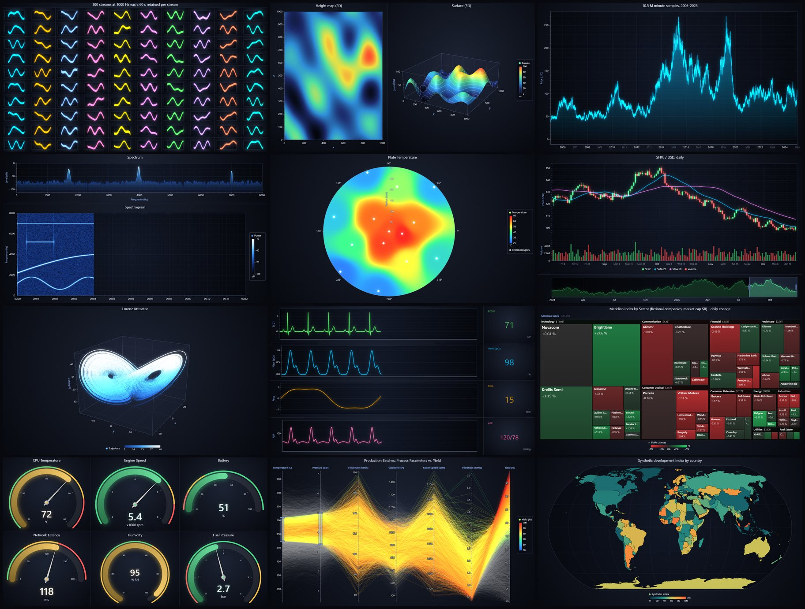

# Sferic Charts

GPU-accelerated charting for the browser. Sferic renders millions of data points
at interactive frame rates with WebGL2, ships with a dark, glowing default theme,
and uses a fluent builder API. Zero runtime dependencies.



> A *sferic* is the broadband radio impulse emitted by a lightning stroke.

## Highlights

- **Large data:** 10M+ point line charts stay interactive through a per-chunk min/max
  level-of-detail pyramid; 1M-point scatter plots with per-point colors pan smoothly.
- **Real-time:** scrolling, sweeping and multi-channel streaming; a 100-chart live
  dashboard renders in about 9 ms per frame on an integrated GPU.
- **Precision:** data is stored per chunk relative to a float64 origin, so epoch
  timestamps zoom down to microseconds without jitter.
- **Unlimited charts per page:** all charts share one WebGL context and draw into
  their own canvases, avoiding the browser's limit of about 16 WebGL contexts.
- **Looks good by default:** five themes (`storm`, `daylight`, `aurora`, `lagoon`, `graphite`);
  the default `storm` adds GPU bloom glow. Series palettes are validated for
  color-vision-deficiency separation.

## Chart types

| Family | What you get |
|---|---|
| `ChartXY` | Line, point, point-line, area, area range, step, spline, heatmap grid, scrolling heatmap, box and whiskers, OHLC / candlestick, rectangles, segments, ellipses |
| Axes | Numeric, logarithmic, DateTime (years to microseconds), elapsed Time; stacked and opposite axes; scroll strategies; bands, constant lines, custom ticks |
| `Dashboard` | Grid of any charts on one canvas, draggable splitters, synchronized axes and cursors |
| `Chart3D` | Point, line, surface grid, scrolling surface, mesh model, box series; orbit camera |
| `Polar`, `Spider` | Polar line, point, area, polygon and heatmap series; radar charts |
| `Pie`, `Gauge`, `Funnel`, `Pyramid` | Pie and donut, animated gauges, funnel and pyramid |
| `BarChart` | Vertical, horizontal, grouped, stacked, animated (racing) bars |
| `ZoomBandChart`, `ParallelCoordinateChart` | Overview range selector; brushing and LUT-colored parallel coordinates |
| `TreeMapChart`, `SunburstChart` | Hierarchies with drill-down |
| `DataGrid`, `Map` | Canvas data grid with sparklines and change flashes; world map from TopoJSON or GeoJSON |

## Quick start

Sferic is not published to npm yet. Build it from source:

```bash
git clone https://github.com/murr2k/sferic-charts.git
cd sferic-charts
npm install
npm run build:lib        # dist/sferic.js (ES module), dist/sferic.umd.cjs, dist/types
```

```ts
import { sferic, AxisTickStrategies, Themes } from 'sferic-charts'

const chart = sferic()
  .ChartXY({ container: 'chart', theme: Themes.storm })
  .setTitle('Day-ahead Power Price')

chart.axisX.setTickStrategy(AxisTickStrategies.DateTime)
chart.axisY.setTitle('Price').setUnits('EUR/MWh')

chart
  .addLineSeries()
  .setName('Day-ahead')
  .appendJSON([
    { x: new Date(2025, 2, 3, 0).getTime(), y: 61.4 },
    { x: new Date(2025, 2, 3, 1).getTime(), y: 58.9 },
  ])
```

`container` takes an element or an element id; without one the chart fills the window.
Sferic requires WebGL2 (all current desktop and mobile browsers).

### Real-time streaming

```ts
import { sferic, AxisTickStrategies, AxisScrollStrategies } from 'sferic-charts'

const chart = sferic().ChartXY({ container: 'chart' })
chart.axisX
  .setTickStrategy(AxisTickStrategies.Time)
  .setScrollStrategy(AxisScrollStrategies.scrolling)
  .setDefaultInterval((s) => ({ end: s.dataMax ?? 0, start: (s.dataMax ?? 0) - 10_000, stopAxisAfter: false }))

const series = chart.addLineSeries().setMaxSampleCount(100_000)
let t = 0
setInterval(() => {
  const ys = Float32Array.from({ length: 50 }, () => Math.random())
  series.appendSamples({ start: t, step: 1, yValues: ys })
  t += 50
}, 50)
```

### Heatmap with a color palette

```ts
import { sferic, LUT, PalettedFill, regularColorSteps, Themes } from 'sferic-charts'

const theme = Themes.storm
const chart = sferic().ChartXY({ container: 'chart', theme })
const lut = new LUT({ steps: regularColorSteps(0, 100, theme.examples.intensityColorPalette), units: 'dB' })
chart
  .addHeatmapGridSeries({ columns: 1000, rows: 1000, dataOrder: 'rows' })
  .setFillStyle(new PalettedFill({ lut }))
  .setIntensityInterpolation('bilinear')
  .invalidateIntensityValues(matrix) // number[][], rows x columns
chart.legend.add(lut, { name: 'Level' })
```

### Dashboards

```ts
const dash = sferic().Dashboard({ container: 'app', numberOfColumns: 2, numberOfRows: 2 })
const a = dash.createChartXY({ columnIndex: 0, rowIndex: 0 })
const b = dash.createChartXY({ columnIndex: 1, rowIndex: 0 })
const g = dash.createGaugeChart({ columnIndex: 0, rowIndex: 1, columnSpan: 2 })
```

## Porting from LightningChart JS

Many Sferic builder methods share names with LightningChart JS (`ChartXY`,
`Dashboard`, `axisX`, `setTickStrategy`, `addLineSeries`, `appendSamples`,
`addHeatmapGridSeries`, `LUT`, `PalettedFill`, ...), so much existing code maps over
with small edits. Sferic does not export a function under that product's name; alias
the factory yourself if you want to keep your call sites:

```ts
import { sferic as lightningChart } from 'sferic-charts'
```

Theme names differ (use `Themes.storm` and friends), no license key is needed, and
less common APIs and visual details are not identical. The gallery examples are the
best reference for what is covered.

## How it works

- One process-wide WebGL2 context. Each standalone chart or dashboard owns a single
  visible 2D canvas; per frame it draws backgrounds and grids (Canvas2D), renders all
  GPU content into the shared context and copies it in, then draws axes, labels,
  legends and cursors (Canvas2D).
- Lines are instanced capsules with signed-distance antialiasing in the fragment
  shader; points are instanced quads with SDF shapes; heatmaps are float textures
  colored through a LUT texture.
- Series data lives in chunks of up to 32K points, each relative to its own float64
  origin. Chunk buffers are only ever re-specified whole (no partial updates of
  buffers in flight, which stall ANGLE/D3D11); newly appended samples are drawn from
  a small per-frame tail buffer until committed.
- Glow is a bloom post-process over multiple render targets. MSAA is enabled only for
  charts that draw un-antialiased triangles (3D, filled polygons).
- Rendering is on demand: nothing is drawn unless data, layout, interaction or an
  animation changed.

## Performance

Measured with `npm run bench` (headless Chrome, real GPU, vsync off) on an Intel Arc
integrated GPU at 1920x1080:

| Scenario | Median frame |
|---|---|
| 1M-point scatter, per-point colors, panning | 1.6 ms |
| 10 channels x 1 kHz streaming | 1.7 ms |
| Real-time FFT spectrogram | 3.3 ms |
| 10M-point line, wheel zooming | 6.3 ms |
| 100 live charts in one dashboard | 9.2 ms |

## Development

```bash
npm install
npm run dev              # gallery at http://127.0.0.1:8779 (run.cmd on Windows)
npm run typecheck
npm run build:lib        # library bundle and type declarations
npm run build            # static gallery build
npm test                 # map decoder hostile-input tests
npm run snap             # screenshot every example headlessly; fails on page or WebGL errors
npm run test:browser     # context loss, no-WebGL, GPU memory and accessibility checks
npm run bench            # frame-time benchmarks
npm run verify:package   # pack, install into a clean project, check imports and types
```

`prepublishOnly` runs typecheck, tests, the library build and `verify:package`, so a
broken or stale build cannot be published.

`snap` and `bench` drive your installed Chrome or Edge through puppeteer-core and need
the dev server running. Gallery examples live in `gallery/examples/`, one file each,
and are discovered automatically.

## License

MIT. See [LICENSE](LICENSE).

## Trademarks

LightningChart is a trademark of LightningChart Ltd. Sferic Charts is an independent
open-source project and is not affiliated with, endorsed by, or sponsored by
LightningChart Ltd. References to LightningChart JS describe API familiarity only.
